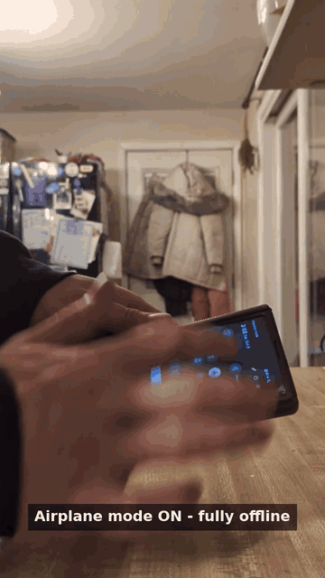
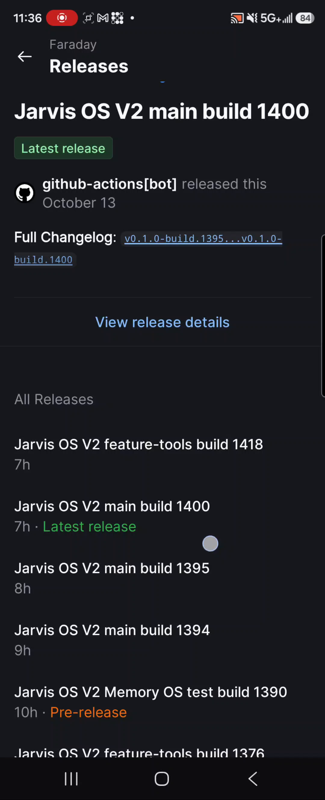
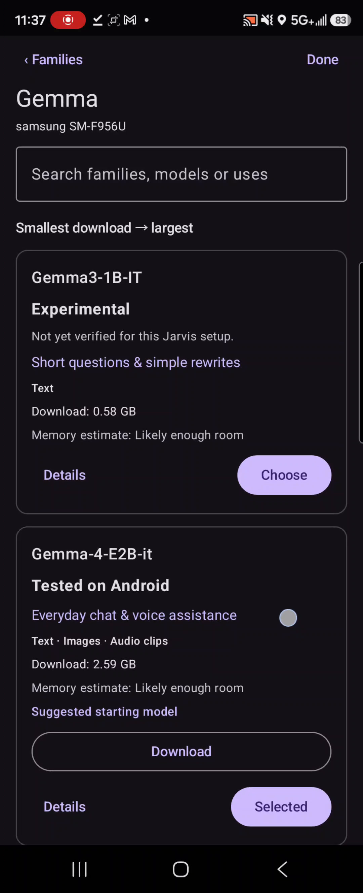
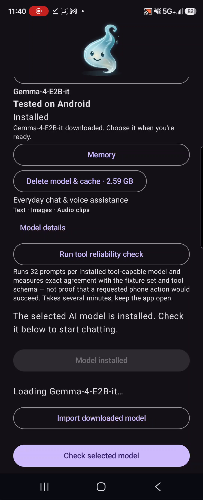
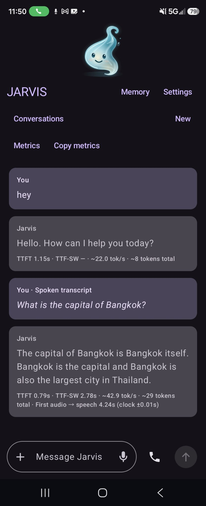
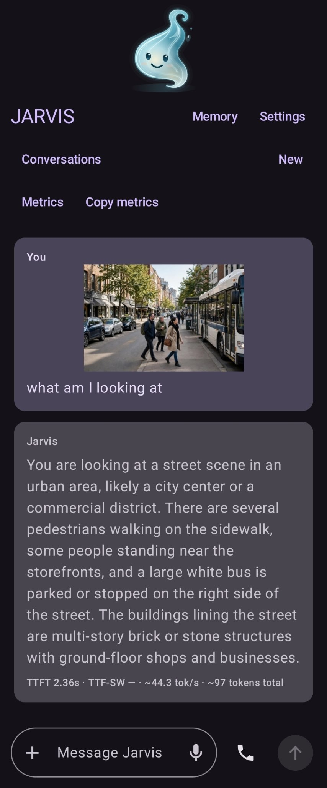

  

<h1 align="center">Faraday</h1>

<strong>A private offline Android voice agent.</strong>

The conversation runs on your phone, including speech recognition, AI inference, and the spoken reply.

  
  
  
  

  <a href="https://github.com/battlesbudz/Faraday/releases">Download for Android</a> · <a href="https://cdn.jsdelivr.net/gh/battlesbudz/Faraday@main/demo/jarvis-voice-demo.mp4">Watch the demo</a>

<a href="https://cdn.jsdelivr.net/gh/battlesbudz/Faraday@main/demo/jarvis-voice-demo.mp4">
  <picture>
    <source media="(prefers-reduced-motion: reduce)" srcset="demo/faraday-demo-thumbnail.jpg">
    
  </picture>
</a>

*53 seconds: airplane mode, wake-word activation, and interrupting a spoken reply.*

Table of contents

- [Performance](#performance)
- [Get started](#get-started)
- [What you can do](#what-you-can-do)
- [Capability comparison](#capability-comparison)
- [In testing](#in-testing)
- [Memory](#memory)
- [Privacy](#privacy)
- [Documentation and contributing](#documentation-and-contributing)
- [License](#license)

## Performance

Measured median response time 
**2.5 seconds from speech end to playback** 
Samsung Galaxy Z Fold 6 · Gemma E2B

## Get started

You’ll need a phone running Android 11 or later and an internet connection for the initial downloads.

- **Storage:** Gemma E2B is about 2.6 GB and E4B about 3.7 GB, plus roughly 280 MB for speech models. Sizes vary by model and version. Installation also needs additional temporary space.
- **RAM:** We recommend 12 GB, matching the Samsung Galaxy Z Fold 6 used for testing.

*Watch: releases page to model download in 35 seconds.*

1. Download and install the APK from the [releases page](https://github.com/battlesbudz/Faraday/releases).

  

2. Open the app, choose a Gemma model, and select **“Download selected model and voice setup.”**

  

3. When the downloads finish, select **“Check selected model”** and allow microphone access when prompted.

  

4. Start a voice call. When wake-word listening is active, say **“Hey Jarvis,”** Faraday’s current wake phrase, and ask a question.

For phone actions and natural speech interruption, select **Speech recognition** in voice settings.

## What you can do

- **Voice and text chat.** Talk to Faraday hands-free or type your messages in the chat.

  

- **Keep talking hands-free.** Wake-word listening works with the screen off or another app open while the voice service is active.
- **Full-duplex audio and barge-in.** Faraday listens while it speaks, so you can interrupt a reply and redirect the conversation.
- **Use phone actions.** Check battery level, adjust media volume, open installed apps, and control media playback with play, pause, next, and previous.
- **Use automatic memory.** Faraday saves relevant information from your conversations automatically. Review, correct, or erase what it remembers.
- **Manage your conversations.** Return to saved chats, delete conversations, or start a private chat.
- **See response timings.** Open a reply’s measurements and export conversation metrics as JSON or CSV.
- **Ask about photos.** Send Faraday a picture and get a detailed on-device description.

  

## Capability comparison

| Capability | Faraday | PocketPal AI | Off Grid AI Mobile | Google AI Edge Gallery |
|---|---|---|---|---|
| Local AI and model choice | Yes | Yes | Yes | Yes |
| Offline spoken conversation | Speech input and output | Spoken output; no built-in speech input found | Local speech input; Pro adds spoken output | Local audio input; no spoken-response loop found |
| Wake word while locked or in the background | Yes, while listening is active | Not found | Not found; background speech pauses | Not found |
| Speak over a reply to interrupt | Yes | Tap-to-stop speech | Spoken interruption unverified | Not found |
| Phone and media controls | Battery, volume, app launch, play/pause/next/previous | No phone/media controls found | Battery and device information | Flashlight, contacts, maps, calendar and settings actions |
| Automatic personal memory across chats | Yes, with an editable local memory wiki | Not found; saved chats and personas | Pro advertises persona memory; automatic capture unverified | Not found; saved sessions |
| Saved conversation history | Yes | Yes | Yes | Yes |
| Performance measurements | Voice-pipeline timings and exports | Generation timings and benchmarks | Generation timings | Inference metrics and benchmark CSV |

“Not found” means absent from the Android implementation reviewed, rather than an assumption based on the marketing page. This is a source-code comparison, not a new side-by-side device test.

Comparison sources and scope

Reviewed October 13, 2026. Faraday entries cover main and the audited working branches, including the automatic-memory additions in the tools branch. Source branches can contain capabilities newer than a published APK.

- **Faraday:** [wake-word listening](https://github.com/battlesbudz/Faraday/blob/2921c2f91e7f5d39d36c9c69ce350e7e2505e3b7/app/src/main/java/com/battlesbudz/jarvis/v2/voice/PassiveWakeListener.kt), [interruption during playback](https://github.com/battlesbudz/Faraday/blob/2921c2f91e7f5d39d36c9c69ce350e7e2505e3b7/app/src/main/java/com/battlesbudz/jarvis/v2/voice/ReplyVoiceCapture.kt), [phone and media actions](https://github.com/battlesbudz/Faraday/blob/68e6426a940b9b42b4f9fe7500fdfa93e0c62fd4/app/src/main/java/com/battlesbudz/jarvis/v2/actions/AndroidMobileActionExecutor.kt), [automatic memory](https://github.com/battlesbudz/Faraday/blob/7465c6e43c03ee3d4454fa348b5d63019a6c63e4/app/src/main/java/com/battlesbudz/jarvis/v2/memory/AutomaticMemory.kt), [editable memory wiki](https://github.com/battlesbudz/Faraday/blob/7465c6e43c03ee3d4454fa348b5d63019a6c63e4/app/src/main/java/com/battlesbudz/jarvis/v2/ui/MemoryScreen.kt), [benchmark exports](https://github.com/battlesbudz/Faraday/blob/2921c2f91e7f5d39d36c9c69ce350e7e2505e3b7/app/src/main/java/com/battlesbudz/jarvis/v2/ui/PipelineBenchmarkScreen.kt).
- **PocketPal AI:** [project overview](https://github.com/a-ghorbani/pocketpal-ai/blob/951ad1bc562bd4c383fc638e6a3a63fef12358dd/README.md), [Android manifest](https://github.com/a-ghorbani/pocketpal-ai/blob/951ad1bc562bd4c383fc638e6a3a63fef12358dd/android/app/src/main/AndroidManifest.xml), [speech output](https://github.com/a-ghorbani/pocketpal-ai/blob/951ad1bc562bd4c383fc638e6a3a63fef12358dd/src/store/TTSStore.ts), [tool registry](https://github.com/a-ghorbani/pocketpal-ai/blob/951ad1bc562bd4c383fc638e6a3a63fef12358dd/src/services/talents/index.ts), [chat context](https://github.com/a-ghorbani/pocketpal-ai/blob/951ad1bc562bd4c383fc638e6a3a63fef12358dd/src/hooks/useChatSession.ts), [metrics](https://github.com/a-ghorbani/pocketpal-ai/blob/951ad1bc562bd4c383fc638e6a3a63fef12358dd/src/components/AssistantTurnFooter/AssistantTurnFooter.tsx).
- **Off Grid AI Mobile:** [product and Pro features](https://getoffgridai.co/mobile/), [project overview](https://github.com/off-grid-ai/OGAM/blob/0ecd4be7d50fc2c73025e7bb6bacfcf0e9cd9a12/README.md), [voice settings](https://github.com/off-grid-ai/OGAM/blob/0ecd4be7d50fc2c73025e7bb6bacfcf0e9cd9a12/src/components/settings/voiceSections.tsx), [listening/speaking behavior](https://github.com/off-grid-ai/OGAM/blob/0ecd4be7d50fc2c73025e7bb6bacfcf0e9cd9a12/src/components/ChatInput/useSilenceEndpoint.ts), [background behavior](https://github.com/off-grid-ai/OGAM/blob/0ecd4be7d50fc2c73025e7bb6bacfcf0e9cd9a12/src/bootstrap/hookRegistry.ts), [tool registry](https://github.com/off-grid-ai/OGAM/blob/0ecd4be7d50fc2c73025e7bb6bacfcf0e9cd9a12/src/services/tools/registry.ts), [metrics](https://github.com/off-grid-ai/OGAM/blob/0ecd4be7d50fc2c73025e7bb6bacfcf0e9cd9a12/src/components/ChatMessage/components/GenerationMeta.tsx). Pro advertises persona memory; automatic mobile capture was not verified from the available public implementation.
- **Google AI Edge Gallery:** [project overview](https://github.com/google-ai-edge/gallery/blob/4928788ef07cdf2194fc435a0f446cf3b997bd5d/README.md), [audio recording](https://github.com/google-ai-edge/gallery/blob/4928788ef07cdf2194fc435a0f446cf3b997bd5d/Android/src/app/src/main/java/com/google/ai/edge/gallery/ui/common/chat/AudioRecorderPanel.kt), [Android manifest](https://github.com/google-ai-edge/gallery/blob/4928788ef07cdf2194fc435a0f446cf3b997bd5d/Android/src/app/src/main/AndroidManifest.xml), [mobile actions](https://github.com/google-ai-edge/gallery/blob/4928788ef07cdf2194fc435a0f446cf3b997bd5d/Android/src/app/src/main/java/com/google/ai/edge/gallery/customtasks/mobileactions/MobileActionsViewModel.kt), [saved sessions](https://github.com/google-ai-edge/gallery/blob/4928788ef07cdf2194fc435a0f446cf3b997bd5d/Android/src/app/src/main/java/com/google/ai/edge/gallery/agent/sessions/DefaultLlmSessionManager.kt), [live metrics](https://github.com/google-ai-edge/gallery/blob/4928788ef07cdf2194fc435a0f446cf3b997bd5d/Android/src/app/src/main/java/com/google/ai/edge/gallery/ui/common/chat/LiveMetricsBar.kt), [benchmark CSV](https://github.com/google-ai-edge/gallery/blob/4928788ef07cdf2194fc435a0f446cf3b997bd5d/Android/src/app/src/main/java/com/google/ai/edge/gallery/ui/benchmark/BenchmarkResultsViewer.kt).

## In testing

These capabilities are being tested and may not work reliably yet.

- **Set reminders and check your schedule.** Create reminders, view scheduled tasks, and receive notifications.
- **Interact with your screen.** Let Faraday read screen content, tap controls, scroll, and enter text with the required permissions.
- **Browse the web.** Open and read pages, follow links, fill forms, and take over when you need to.
- **Run workflows.** Schedule routines, review approvals, track progress, and cancel tasks.
- **Connect services.** Set up MCP connections, discover available tools, and manage their permissions.

## Memory

Faraday can remember information across conversations automatically, without you having to ask it to save each detail. You can review what it remembers, make corrections, or erase it.

## Privacy

Faraday runs entirely on your phone. Your voice, AI processing, conversations, and memories stay on the device during offline use. Once the models are downloaded, you can talk to Faraday in airplane mode with no internet connection.

When online, Faraday can look things up through Wikipedia or Wikidata, or open a website link you provide. Those requests send the search query or request to the relevant website. Any external services you choose to connect also receive the information needed to carry out your requests.

## Documentation and contributing

The app uses Kotlin and Jetpack Compose, with Gemma through LiteRT-LM, Whisper for speech recognition, and Piper for speech output.

- [Setup and build instructions](https://github.com/battlesbudz/Faraday/blob/audio-pr2/docs/architecture/development.md)
- [Architecture](https://github.com/battlesbudz/Faraday/blob/audio-pr2/docs/architecture/README.md)
- [Measurements and benchmarks](https://github.com/battlesbudz/Faraday/blob/audio-pr2/docs/verification/pipeline-benchmarks.md)
- [Contribution guide](https://github.com/battlesbudz/Faraday/blob/audio-pr2/CONTRIBUTING.md)

Found a problem or have an idea? [Open an issue](https://github.com/battlesbudz/Faraday/issues). For bugs, include your phone, Android version, app version, selected model, and steps to reproduce. Remove private conversation content before sharing logs.

## License

Faraday is source-available under the [PolyForm Noncommercial License 1.0.0](https://github.com/battlesbudz/Faraday/blob/audio-pr2/LICENSE.md). Commercial use requires permission. Model and dependency licenses apply separately.
